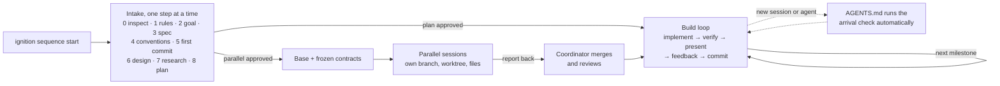

# Ignition Sequence Start

**Set up any project for coding agents once, then keep it moving across sessions, tools and parallel workers.**

Ignition Sequence Start is an [Agent Skill](https://agentskills.io). Say "ignition sequence start" in a repository and the agent interviews you one step at a time (rules, goal, spec, conventions, design, research, plan), writes everything into a small set of Markdown files, and starts building only after you approve the plan. From then on, every new session and every agent you switch to picks up where the last one stopped, because the project's memory lives in the repository instead of a chat.

## Why

Coding agents are fast but start every session without context. Most trouble in agent-built projects comes from a few predictable places:

- Requirements that exist only in a chat that gets summarized, forgotten, or left behind when switching tools.
- Agents that guess at ambiguous requirements instead of asking.
- No shared definition of "done", so unverified work is reported as finished.
- Review feedback sent as long messages, with items silently dropped.
- Parallel agents editing the same files and breaking each other's assumptions.

This skill addresses each one: a structured intake, a docs system every agent reads, a build loop with a real verification gate, a handoff protocol, and a contract-based method for running agents in parallel.

## How it works



1. **Intake.** Each step asks for one thing. Paste what you already have, or answer a few numbered questions; short replies such as `yes; no; later; what you suggest` work. The agent keeps your wording, lists ambiguities separately instead of guessing, shows what it wrote, and waits for your go. Nothing is implemented during intake, and nothing is committed without your explicit approval.
2. **Build loop.** One approved milestone at a time. "Done" means it builds without new warnings, the tests pass, and the agent ran the result and checked it, not only compiled it. Review requests get IDs in `docs/feedback.md`, and each is reported back as done, partly done, or not done.
3. **Continuity.** The project's `AGENTS.md` is loaded automatically by every agent. It tells each new session to read `docs/progress.md`, check git, and orient you before working. Before stopping, the agent records the phase, the next action, and anything in flight.
4. **Parallel work (optional).** After a shared base and frozen contracts exist, independent milestones can run in separate sessions, each with its own branch, worktree, files, resources and reserved commit versions. Each session reports back to a coordinating session, which merges, integrates and reviews.

## Your journey

| You want to | Do this |
|-------------|---------|
| Start a project | Say **"ignition sequence start"**. Answer one step at a time, or paste what you have. |
| Start quickly | Say "ignition sequence start, express". You get defaults for the rules, two questions (goal and spec), and one plan approval. |
| Continue in a new session or another agent | Just start talking. `AGENTS.md` makes the agent check status first. If it does not, paste the resume prompt below. |
| Stop or switch tools | Say **"handoff"** or "wrap up". The agent records the status and what is in flight. |
| Know where things stand | Say **"status"**. You get the phase, what is signed off, open feedback, skipped items, and questions for you. |
| Send review feedback | Send a numbered list. Each item gets an ID and is reported back individually. |
| Add features after the plan | Describe them. They are written into the spec with IDs and planned before any code. |
| Step away while work continues | Say "I'll be away, keep going". The agent agrees the boundary, stays inside it, and leaves a short report. |
| Run work in parallel | Ask, for example "run M3 and M4 in parallel". The agent checks readiness, sets up contracts and ownership, and gives you one prompt per session. |

These phrases work in any agent once the project is set up, because they are written into the project's `AGENTS.md`.

## What it creates

```
your-project/
├── AGENTS.md              # rules for every agent: session start, shortcuts, workflow, verify, git, handoff
├── CLAUDE.md              # "@AGENTS.md" pointer for Claude Code (GEMINI.md, .aider.conf.yml optional)
├── docs/
│   ├── product.md         # what, why, goal, users, success, non-goals
│   ├── spec.md            # requirements with IDs, assumptions, ambiguities, open questions
│   ├── design.md          # vision, design requirements, approved direction
│   ├── research.md        # dated findings with sources
│   ├── progress.md        # status, next action, in flight, milestones, decisions
│   ├── feedback.md        # review requests with IDs and status
│   ├── parallel-plan.md   # parallel work only: ownership, contracts, report-back
│   └── milestones/        # parallel work only: one report per milestone
└── references/
    └── README.md          # index of visual references, shared patterns first
```

Small projects get a light setup: `AGENTS.md`, `CLAUDE.md`, `docs/spec.md`, `docs/progress.md` and `docs/feedback.md`.

`AGENTS.md` is the single source of rules. Agents that do not read it natively get a one-line pointer, never a copy, so instructions cannot drift apart.

## Install

**Any agent, with the [skills CLI](https://github.com/vercel-labs/skills)** (interactive; pick your agents, or pass `-a`):

```bash
npx skills add imjustinliao/Skill-Ignition-Sequence-Start
npx skills add imjustinliao/Skill-Ignition-Sequence-Start -a claude-code -a codex -a cursor -a gemini-cli -a grok
```

**Claude Code, as a plugin:**

```text
/plugin marketplace add imjustinliao/Skill-Ignition-Sequence-Start
/plugin install ignition-sequence-start@skill-ignition-sequence-start
```

**Manually:** copy `skills/ignition-sequence-start/` into a skills folder your agent reads. `~/.agents/skills/` is shared by most agents; Claude Code uses `~/.claude/skills/`.

```bash
git clone https://github.com/imjustinliao/Skill-Ignition-Sequence-Start.git
cp -r Skill-Ignition-Sequence-Start/skills/ignition-sequence-start ~/.agents/skills/   # most agents
cp -r Skill-Ignition-Sequence-Start/skills/ignition-sequence-start ~/.claude/skills/   # Claude Code
```

**Claude apps:** zip the `ignition-sequence-start` folder and upload it under Customize › Skills.

## Compatibility

The skill uses only the open [Agent Skills](https://agentskills.io) format and plain Markdown, so it runs in any agent that can read files and run shell commands. After setup, continuity comes from `AGENTS.md`, which nearly every agent loads automatically.

| Agent | Skill folder (user-level) | Project instructions |
|-------|---------------------------|----------------------|
| Claude Code | `~/.claude/skills/` | `CLAUDE.md` with `@AGENTS.md` (created automatically) |
| Codex | `~/.agents/skills/` | `AGENTS.md` |
| Cursor | `~/.cursor/skills/` or `~/.agents/skills/` | `AGENTS.md` |
| Gemini CLI | `~/.gemini/skills/` or `~/.agents/skills/` | `GEMINI.md` with `@AGENTS.md` (scaffold `--gemini`) |
| Grok Build | `~/.grok/skills/` or `~/.agents/skills/` | `AGENTS.md` |
| GitHub Copilot | `~/.copilot/skills/` or `~/.agents/skills/` | `AGENTS.md` |
| Windsurf / Devin | `~/.codeium/windsurf/skills/` or `~/.agents/skills/` | `AGENTS.md` |
| OpenCode | `~/.config/opencode/skills/` or `~/.agents/skills/` | `AGENTS.md` |
| Cline | `~/.cline/skills/` | `AGENTS.md` |
| Roo Code, Kilo Code | `~/.agents/skills/` | `AGENTS.md` |
| Goose, OpenHands, Crush, Amp, Warp, Junie, Factory Droid, Mistral Vibe | `~/.agents/skills/` | `AGENTS.md` |
| Qwen Code | `~/.qwen/skills/` | `AGENTS.md` |
| Kiro | `~/.kiro/skills/` | `AGENTS.md` |
| Zed | `~/.agents/skills/` | `AGENTS.md` (remove or merge any `.rules` file, which takes precedence) |
| Aider | no skill support | `.aider.conf.yml` with `read: AGENTS.md` (scaffold `--aider`) |

**Agents without skill support:** ask the agent once to read `skills/ignition-sequence-start/SKILL.md` from this repository and follow it. After setup, the project's `AGENTS.md` carries the workflow on its own.

Agent support changes often. If a folder does not work, check your agent's current documentation.

## Resume prompt

Agents normally run the arrival check on their own. If one does not, paste this, even into an agent without the skill installed:

```text
Continue this project. Read AGENTS.md, then docs/progress.md, then check `git status` and `git log -5`. Tell me in three lines: the phase, what was last done, and the next action (plus anything in flight or uncommitted). Then wait for my go, unless progress.md says the next action is already approved.
```

## Parallel agents

Once the plan is approved, ask for parallel work. The agent first checks that the work splits cleanly and that the project is ready, then:

1. Lands a **base** on the main branch: shared foundations plus **frozen contracts** (interfaces, types, schemas, routes, mocks) with tests.
2. Writes `docs/parallel-plan.md`: waves, branches, worktrees, an **ownership map**, reserved names and commit versions, the quality bar, and the report-back protocol.
3. Gives you one **self-contained prompt** per session to paste into a new agent.
4. Each session works only in its own worktree and files, writes `docs/milestones/<m>.md`, pushes its branch, and reports `M3 done: milestone/m3-… pushed at <hash>` to the coordinator, or asks you to paste the report.
5. The **coordinator** merges in dependency order, runs the full verification gate, does a consistency pass, walks you through sign-off, and cleans up worktrees and branches.

Two to four writers at once is the practical range. Beyond that, merging and review cost more than the parallelism saves.

## Why one skill

Setup, handoffs, status checks and parallel planning could be separate skills. They are one skill because:

- **After setup, the project runs itself.** The shortcuts live in the project's `AGENTS.md`, so switching sessions or agents needs no skill and no special command.
- **One install, one entry point.** A router at the top of `SKILL.md` picks the mode from the repository's state and your words; only the relevant reference file is loaded.
- **No duplicated templates.** Every mode shares the same docs system, so there is a single copy to maintain.

## Customize

Fork the repository and adjust the defaults:

- `skills/ignition-sequence-start/assets/templates/AGENTS.md`: session start, shortcuts, workflow, principles, approval modes, commit rules.
- `skills/ignition-sequence-start/references/intake.md`: the steps, their order, and the questions asked.
- `skills/ignition-sequence-start/references/workflow.md`: the verification gate, feedback handling and versioning rules.

The default commit format is `MAJOR.MINOR.PATCH - What changed` (for example `0.3.0 - Add search with filters`). Step 4 lets each project choose another, such as Conventional Commits.

## Repository layout

```
skills/ignition-sequence-start/
├── SKILL.md                 # router, kickoff steps, build loop, principles
├── references/              # loaded only when needed
│   ├── intake.md            # steps 0–8, sizing, express kickoff, existing projects
│   ├── docs-system.md       # file roles, size budgets, agent pointer files
│   ├── workflow.md          # build loop, verification, feedback, new scope, away mode, versioning
│   ├── handoff.md           # leaving, arriving, switching tools, two agents at once
│   ├── parallel.md          # subagents, parallel sessions, contracts, merging
│   └── situations.md        # edge cases and how to handle them
├── assets/
│   ├── templates/           # files copied into your project
│   └── prompts/             # resume and parallel-session prompts
└── scripts/scaffold.py      # copies templates without overwriting (Python 3, no dependencies)
```

## Contributing

Issues and pull requests are welcome, especially reports on how the intake and handoff work in different agents. Keep `SKILL.md` short; detail belongs in `references/`.

## License

[MIT](LICENSE) © 2026 Justin Liao
