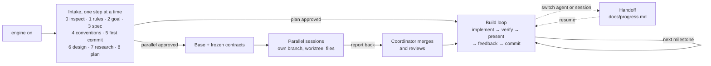

# Engine-on

**Start any project in a coding agent the right way, and keep it moving across agents, sessions and parallel workers.**

Engine-on is an [Agent Skill](https://agentskills.io). Say "engine on" in a repo and your agent interviews you one step at a time (rules, goal, spec, conventions, design, research, plan), writes everything into a small set of Markdown files, and only starts building once you approve the plan. From then on, any agent in any tool can pick up where the last one stopped, because the project's memory lives in the repo, not in a chat.

It is distilled from the workflow used to build a production iOS app with coding agents, from an empty repo through six milestone sessions running in parallel and many review rounds.

## Why

Coding agents are fast, but they start every session cold. Most trouble in agent-built projects comes from the same few places:

- Requirements that only exist in a chat that gets summarized, forgotten, or left behind when you switch tools.
- Agents that guess at ambiguous specs instead of asking.
- No shared definition of "done", so unverified work gets presented as finished.
- Review feedback sent in long messages, with items silently dropped.
- Parallel agents editing the same files and breaking each other's assumptions.

Engine-on spends a little time up front so you don't lose it later: a structured intake, a docs system every agent reads, a build loop with a real verification gate, a handoff protocol, and a contract-based way to run agents in parallel.

## How it works



**1. Intake.** Each step asks for one thing. Paste what you already have, or answer a few numbered questions (terse replies like `yes; no; later; what you suggest` work). The agent keeps your wording, lists ambiguities separately instead of guessing, shows you what it wrote, and waits for your go. Nothing is implemented during intake, and nothing is committed without your explicit yes.

**2. Build loop.** One approved milestone at a time. "Done" means it builds without new warnings, the tests pass, and the agent ran it and looked (screenshots, output, interactions), not just compiled it. Your review requests get IDs in `docs/feedback.md` so every item is reported back as done, partly done, or not done.

**3. Handoff.** Before stopping, the agent updates `docs/progress.md`: phase, next action, and anything in flight. The next agent (a fresh session, a different tool, or after a context reset) reads it and tells you where things stand in three lines.

**4. Parallel agents (optional).** Once a shared base and frozen contracts exist, independent milestones can run in separate sessions, each with its own branch, worktree, files, ports or devices, and reserved commit versions. Each writes a report and sends it back to a coordinating session, which merges, integrates and reviews.

## What it creates

```
your-project/
├── AGENTS.md              # rules for every agent: read order, workflow, verify, git, handoff
├── CLAUDE.md              # "@AGENTS.md" (pointer for Claude Code)
├── docs/
│   ├── product.md         # what, why, goal, users, success, non-goals
│   ├── spec.md            # requirements with IDs, ambiguities, open questions
│   ├── design.md          # vision, design requirements, approved direction
│   ├── research.md        # dated findings with sources
│   ├── progress.md        # status, next action, in flight, milestones, decisions
│   ├── feedback.md        # review requests with IDs and status
│   ├── parallel-plan.md   # only for parallel work: ownership, contracts, report-back
│   └── milestones/        # one report per parallel milestone
└── references/
    └── README.md          # index of visual references, shared patterns first
```

`AGENTS.md` is the single source of rules. Agents that don't read it natively get a one-line pointer, never a copy, so instructions can't drift apart.

## Install

**Any agent, with the [skills CLI](https://github.com/vercel-labs/skills):**

```bash
npx skills add imjustinliao/Skill-Engine-on
```

**Claude Code, as a plugin:**

```text
/plugin marketplace add imjustinliao/Skill-Engine-on
/plugin install engine-on@skill-engine-on
```

**Manually:** copy `skills/engine-on/` into your agent's skills folder.

```bash
git clone https://github.com/imjustinliao/Skill-Engine-on.git
cp -r Skill-Engine-on/skills/engine-on ~/.claude/skills/   # Claude Code
cp -r Skill-Engine-on/skills/engine-on ~/.agents/skills/   # Codex, Gemini CLI, Cursor, Copilot, OpenCode, Amp
```

| Agent | User-level folder | Project-level folder |
|-------|-------------------|----------------------|
| Claude Code | `~/.claude/skills/` | `.claude/skills/` |
| Codex | `~/.agents/skills/` | `.agents/skills/` |
| Gemini CLI | `~/.gemini/skills/` or `~/.agents/skills/` | `.gemini/skills/` or `.agents/skills/` |
| Cursor | `~/.cursor/skills/` or `~/.agents/skills/` | `.cursor/skills/` or `.agents/skills/` |
| GitHub Copilot (VS Code) | `~/.copilot/skills/` | `.github/skills/` |
| OpenCode | `~/.config/opencode/skills/` | `.opencode/skills/` |
| Amp | `~/.config/agents/skills/` | `.agents/skills/` |

**Claude apps:** zip the `engine-on` folder and upload it under Customize › Skills.

**An agent without skill support:** tell it `Read skills/engine-on/SKILL.md from https://github.com/imjustinliao/Skill-Engine-on and follow it.`

Skill folders and agent support change quickly; if a path doesn't work, check your agent's current docs.

## Use

In a new or existing repo, say:

```text
engine on
```

The agent looks at the repo first, then picks the right mode:

| The repo has | Engine-on will |
|--------------|----------------|
| No Engine-on docs (empty, or code only) | **Kick off**: run the intake from step 0 |
| An unfinished intake | **Continue** at the first unchecked step |
| A project in progress | **Resume**: read the docs, check git, report status |
| Its own agent files or docs | **Adopt**: merge them into the system, nothing discarded |
| You ask to split the work | **Plan parallel work** |

Tips:

- **Bring what you have.** Prepared goal statements, spec outlines, design briefs and screenshots can be pasted whole; the agent files them.
- **Answer by number.** Questions come numbered so short answers map back cleanly. "What you suggest" accepts the agent's stated default.
- **Skip freely.** "Skip" or "later" parks a step; it stays visible in `docs/progress.md`.
- **Pick an approval mode.** Start with `ask` (the agent asks before each commit or push). Switch to `commit-on-green` (commit and push whenever build and tests pass) when you trust the loop.

### Switching agents or sessions

Paste this into any agent, even one without Engine-on installed:

```text
Continue this project. Read AGENTS.md, then docs/progress.md, then check `git status` and `git log -5`. Tell me in three lines: the phase, what was last done, and the next action (plus anything in flight or uncommitted). Then wait for my go, unless progress.md says the next action is already approved.
```

### Parallel agents

Ask for it once the plan is approved ("can we run M2–M4 in parallel?"). The agent first checks the work actually splits cleanly, then:

1. Lands a **base** on the main branch: shared foundations plus **frozen contracts** (interfaces, types, schemas, routes, mocks).
2. Writes `docs/parallel-plan.md`: waves, branches, worktrees, an **ownership map** (who may edit what), reserved names and commit versions, the quality bar, and the report-back protocol.
3. Gives you one **self-contained prompt** per session to paste into a new agent.
4. Each session works only in its own worktree and files, writes `docs/milestones/<m>.md`, pushes its branch, and reports `M3 done: milestone/m3-… pushed at <hash>` to the coordinator (or asks you to paste the report).
5. The **coordinator** merges in dependency order, integrates, runs the full verification gate, gets an independent review, and walks you through sign-off.

Two to four writers at once is the sweet spot; beyond that, merging and review cost more than the parallelism saves.

## Customize

Fork it and make it yours. Most personal choices live in a few places:

- `skills/engine-on/assets/templates/AGENTS.md`: default workflow, principles, approval modes, commit rules.
- `skills/engine-on/references/intake.md`: the steps, their order, and the questions asked.
- `skills/engine-on/references/workflow.md`: the verification gate and the versioning rules.

The default commit format is `MAJOR.MINOR.PATCH - What changed` (for example `0.3.0 - Add search with filters`). Step 4 lets each project choose another, such as Conventional Commits.

## Layout of this repo

```
skills/engine-on/
├── SKILL.md                 # entry point: modes, the nine steps, the loop, principles
├── references/              # loaded only when needed
│   ├── intake.md            # the steps in detail, question banks, fast paths
│   ├── docs-system.md       # what each file is for, size budgets, agent pointer files
│   ├── workflow.md          # build loop, verification gate, feedback, commits, versioning
│   ├── handoff.md           # leaving, arriving, switching tools, compaction
│   └── parallel.md          # subagents, parallel sessions, contracts, merging
├── assets/
│   ├── templates/           # the files copied into your project
│   └── prompts/             # resume and parallel-session prompts
└── scripts/scaffold.py      # copies templates without overwriting (Python 3, no dependencies)
```

## Contributing

Issues and pull requests are welcome, especially reports of how the intake and handoff hold up in agents other than Claude Code. Keep `SKILL.md` short; detail belongs in `references/`.

## License

[MIT](LICENSE) © 2026 Justin Liao
